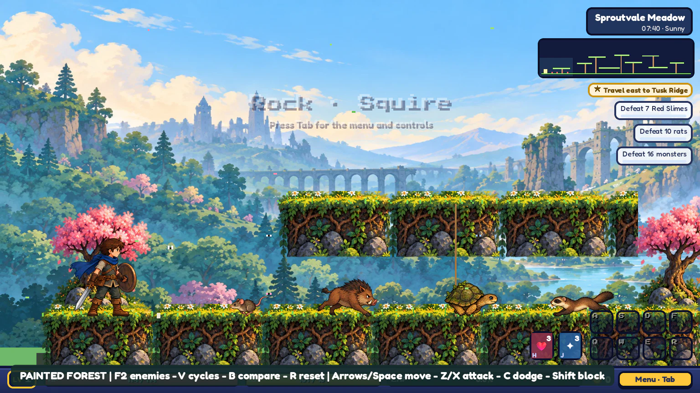
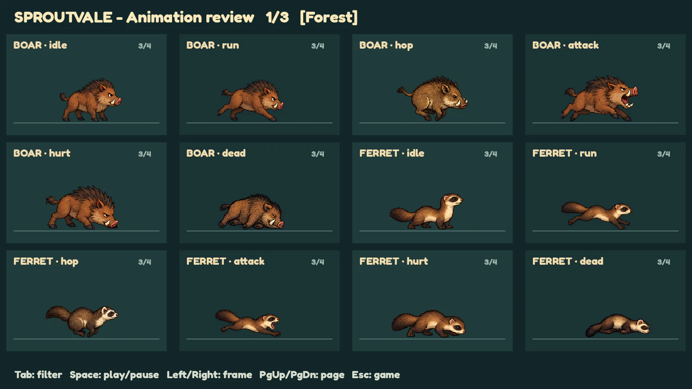
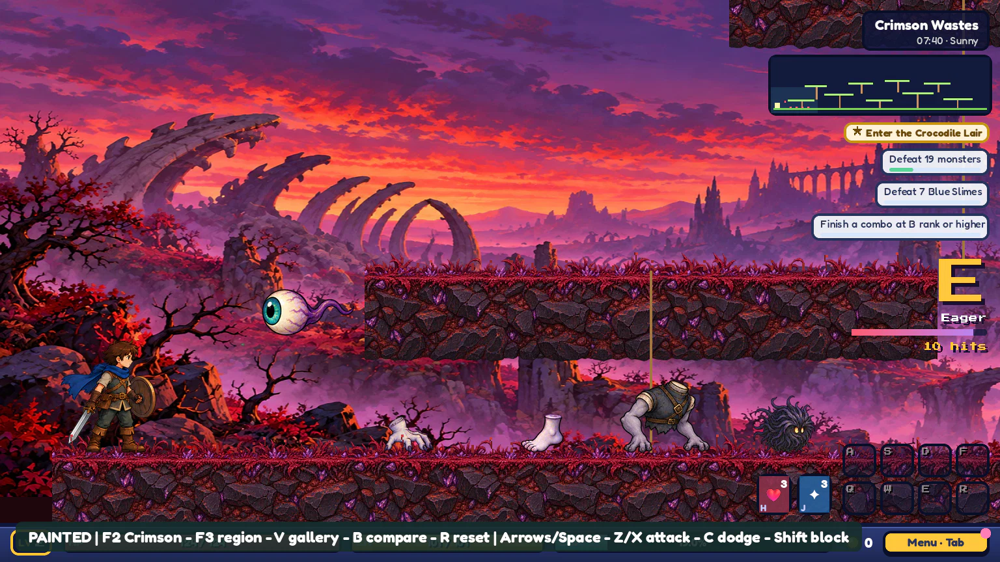
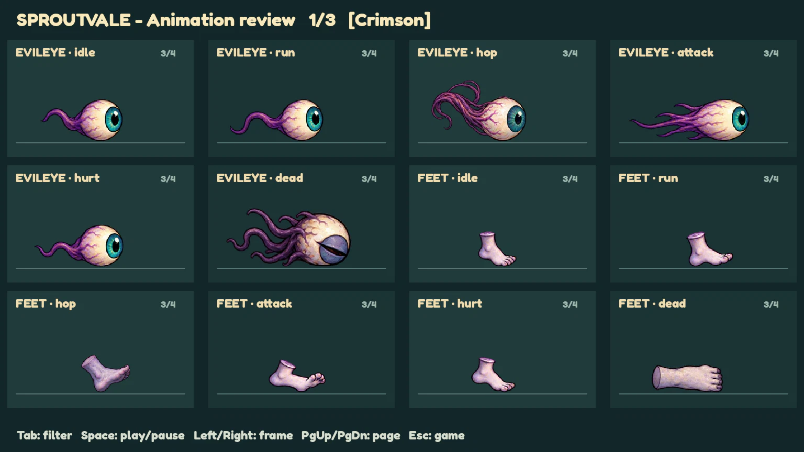
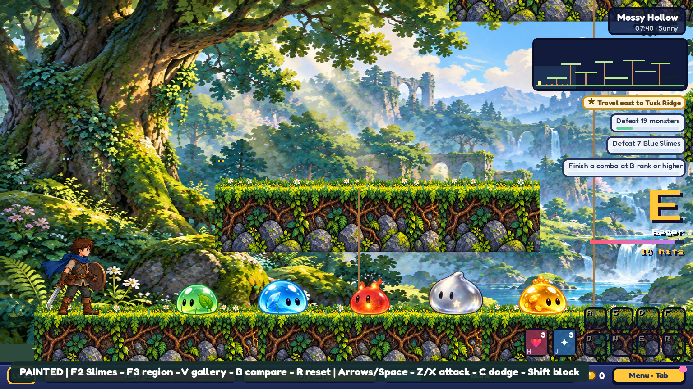
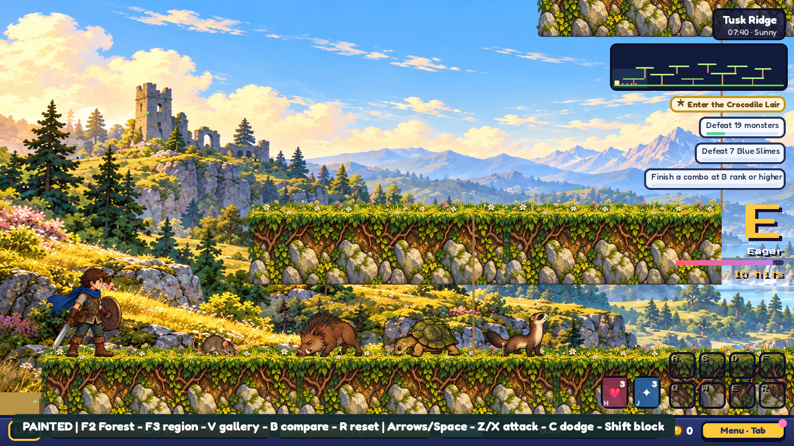

# Painted art overhaul

Work happens on `codex/painted-meadow-sample` in playable batches. The original main scene and normal saves stay available. Each batch records completed assets, remaining work, and verification here.

## Batch 1 - core Rock and green-slime cycles

Completed: 48 painted frames in 12 four-frame strips, exported at four art pixels per world unit.

| Character | Cycles |
| --- | --- |
| Male starter Rock | Idle, walk, run, jump, slash, heavy, dash, block |
| Green slime | Idle, hop, hurt recovery, death |

The current game owns movement, enemy AI, damage frames, attack speed, hitstop and collisions. The painted slash and heavy strike poses are synchronized to the first active damage frame. Unsupported Rock moves still use the sample's earlier key-pose fallback; they have not been completed by this batch. Painted equipment is still drawn as part of the hero, rather than as separate armor and weapon layers.

Review: run `godot/samples/painted_meadow.tscn` with F6. Press V for the animation gallery; Space pauses, Left/Right steps all cycles, and Esc returns to a fresh meadow session. The gallery loops non-looping actions for review; gameplay uses state-specific timing instead.

Verified with Godot 4.7.2: controller smoke checks; twelve valid strips; forty-eight nonempty frames with pose changes; slash/heavy strike timing; gallery playback and four captured review frames.

## Batch 2 - complete starter Rock action coverage

Added 96 frames across 24 distinct strips: rising, thrust, spin, air, climb, swim, crouch, slide, rest, hurt, down, cheer, air2, air3, plungeStart, plungeLand, aegis, whirl, flip, plunge, prone, crawl, proneStab and land. Starter male Rock now has a dedicated painted strip for each of his 32 animation states, totaling 128 hero frames. Green slime adds another 16 frames.

Attacks select their own strip and revisit the strike pose on every active hit of multi-hit moves. Movement and reaction playback preserve the original controller's action durations. The gallery now has pages (PgUp/PgDn); four poses remain intentionally limited animation rather than matching the original per-action frame counts.

Godot 4.7.2 validation: 36 strips, 144 nonempty frames with distinct poses, all 32 Rock state selections, and eleven Rock attack timelines including their extra active hits. Review captured all four frames on each gallery page. Visual review replaced an overlapping knockout source with a separate isolated strip and adjusted rising's startup scale. Local source checkout is partial; unrelated missing original card portraits produce warnings and are not removed from the repository.

Equipment is still baked into these starter poses. Armor tiers, weapon replacement, female Rock, other heroes and full-game integration remain unfinished; this batch does not claim those features.

## Batch 3 - five meadow slime families

Added 64 frames for blue, red, silver and gold slimes: idle, hop, hurt and death for each. These are separately generated designs with crystal, ember, pearl-star and treasure details, respectively. Together with green slime and Rock, the published library contains 52 strips and 208 frames.

The meadow art sample now cycles through all five families when spawning. This isolated encounter uses green-slime level/HP/attack/defense/EXP for every family, retains each family's size and behavior, and disables random shiny conversion. Normal game data and production encounter balance are unchanged. Shiny and elite mobs use original art until their own painted variants exist. Unsupported families also use the original renderer rather than an unrelated painted slime.

Verified in Godot 4.7.2: all 52 strips and 208 nonempty frames; fresh encounter includes every family; real damage selects hurt art and lethal damage selects death art for each family; death reaches its final pose; eleven Rock move timelines; paginated gallery capture. Movement/jump/attack/dodge/block/reset/comparison checks cover the expanded sample. Original mob textures were restored into the partial local checkout to verify the B comparison. Original unrelated card portrait warnings remain.

The sample now restores its texture-cache changes when leaving for the gallery, so returning does not overwrite the original-art comparison reference.

Switching away from male starter Rock or equipping upgraded armor/weapons restores the original hero renderer. The painted starter does not conceal class, gender or equipment changes while their replacement assets are unfinished.

## Batch 4 - forest creature encounters

Added 104 painted frames in 26 strips:

| Family | Strips |
| --- | --- |
| Meadow rat | Idle, run, hop, attack, hurt, death |
| Tusk boar | Idle, run, hop, attack, hurt, death |
| Ferret | Idle, run, hop, attack, hurt, death |
| Moss tortoise | Idle, run, hop, snap, hurt, death, shell withdrawal, shell spin |

The tortoise snap strip is an extra review animation; its existing combat AI uses withdrawal and spin. Rats and ferrets use windup/lunge/recovery poses, boars switch from anticipation into a running charge, and tortoises hold their closed shell and animate the spin. The existing AI, hitboxes, collision surfaces and attack windows own all combat behavior. Hurt playback now starts at its first pose during the existing 0.1-second damage flash. Newly spawned creatures retain the original scale-in effect.

Run `godot/samples/painted_forest.tscn` with F6, or press F2 inside either painted sample to switch encounter families. These forest creatures currently use the existing painted meadow scenery and geometry; this does not complete a new regional map. Preview encounters use starter combat stats and disable shiny conversion, with production data unchanged.

The gallery supports Tab filters for All / Rock / Slimes / Forest. Creature previews are enlarged for inspection. Leaving and returning through the gallery preserves the selected encounter and the original-art comparison cache.

Godot 4.7.2 checks: 78 strips and 312 nonempty frames with pose changes; four creature families spawning; real AI windup-to-attack transitions, animated boar charge and tortoise spin, damage reactions and death poses; F2 encounter switching; gallery filtering and return; B original-art comparison; existing controller checks. Captured four frames on every forest review page. The partial local checkout still lacks unrelated original card portraits, which can generate warnings.

Seven generated source sheets are normalized by `tools/art/batch4.json` using the shared importer. The published WebP strips are directly usable assets; no art-generation step runs during gameplay.

## Batch 5 - Crimson creatures

Adds 31 strips / 124 frames for Evil Eye, Hand, Traveler feet, Torso, and Hair Spike. All five have idle, movement, hop, attack, hurt and death cycles; Hair Spike also has a rolling attack. Sprites follow the existing AI windup, attack and damage timers. Traveler pairing remains intact. Source crops and foot anchors are recorded in `tools/art/batch5.json`; the importer now supports larger canvases for wide silhouettes.

The published total is **109 strips / 436 frames**. Crimson is a fourth gallery filter after Rock, Slimes and Forest. F2 cycles the three encounter groups.

## Batch 6 - Three regional environments

Adds painted backdrops and terrain tiles for Mossy Hollow, Tusk Ridge and the first Crimson Wastes map. F3 cycles the four regional previews, preserving each original map's platforms, ropes and bounds. New scenes `painted_hollow.tscn`, `painted_ridge.tscn` and `painted_crimson.tscn` open their corresponding regions directly. Gallery return preserves both region and encounter; B restores original map and sky textures. Portals remain disabled in the isolated preview.

Regional WebPs are described by `godot/art/painted/environments.json` and normalized by `tools/art/prepare_painted_environments.gd`. No generation or conversion runs during gameplay. Starter stats remain confined to the sample. Later Crimson maps, other regions, UI and production-game integration remain future work.

Validation in Godot 4.7.2: animation manifest and frame checks; all five dark AI attack sequences, paired Travelers, rolling animation, hurt/death playback; all four map geometries and bounds; F2/F3 switching, gallery filter/return, original-art comparison; forest combat regression and movement/jump/attack/dodge/block/reset checks. The partial local checkout lacks unrelated original card portraits, producing warnings.

## Remaining batches

1. Rock equipment-compatible layers, armor tiers and appearance variants. The starter action set is covered by batch 2.
2. Archer, Remy, Jojo and Tank: approve their painted silhouettes, then movement, combat, skills, variants and equipment progression.
3. Remaining monster families and their animation cycles, followed by shiny, elite and lunar variants. The five base meadow slime families are covered by batches 1 and 3; rat, boar, tortoise and ferret base art is covered by batch 4; the five base Crimson families above are covered by batch 5. The original base monster table contains 61 sprite sets including variants; expansion folders add more.
4. World art by region: homes and interiors, pond, remaining Crimson maps, Abyss, mountain/volcano, lunar areas and map screens. Preserve all collision geometry and parallax behavior.
5. Bosses and live-drawn body parts, NPCs, pets, drops, skill effects and remaining interface assets; final consistency and performance pass.

These are work groups, not claims that the remaining assets are finished. Large groups can be split further without mixing unfinished art into the normal game.

## Animation files

`godot/art/painted/animations.json` describes every published strip, scale, foot anchor and source crop. `godot/samples/painted_animation_library.gd` handles reusable playback. Generated source PNGs from the chat can be normalized with `tools/art/prepare_painted_animations.gd` after placing them in `godot/art/painted/sources/`.

Batch 2 sources can be rebuilt with the same importer, passing the source directory and `tools/art/batch2.json` as two user arguments after `--`. The importer merges new strips into the existing manifest. The final knockout repair entry deliberately replaces the original overlapping source.
